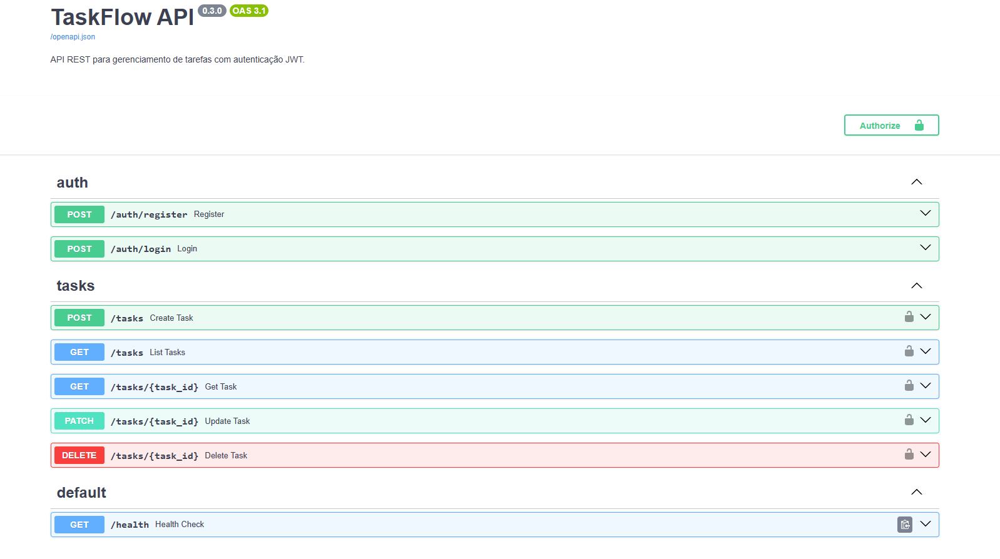

# TaskFlow API


API REST para gerenciamento de tarefas, com autenticação JWT e
isolamento de dados entre usuários.

**Demo ao vivo:** [taskflow-api-n29e.onrender.com](https://taskflow-api-n29e.onrender.com/docs)
**Documentação interativa:** [Swagger UI](https://taskflow-api-n29e.onrender.com/docs)

# Funcionalidades

- Cadastro e login de usuários com tokens JWT
- Senhas protegidas com hash Argon2
- CRUD completo de tarefas, com filtro por status e paginação
- Cada usuário acessa apenas as próprias tarefas
- Validação de dados com Pydantic
- Documentação interativa gerada automaticamente (Swagger)
- Testes automatizados com CI no GitHub Actions



# Tecnologias

| Área | Ferramenta |
|---|---|
| Linguagem | Python |
| Framework | FastAPI |
| Banco de dados | SQLite + SQLAlchemy 2.0 |
| Autenticação | PyJWT, pwdlib (Argon2) |
| Testes | pytest, pytest-cov |
| CI | GitHub Actions |

# Como rodar localmente

```bash
# 1. Clonar o repositório
git clone https://github.com/rudneubert/taskflow-api.git
cd taskflow-api

# 2. Criar e ativar o ambiente virtual
python -m venv .venv
.venv\Scripts\Activate.ps1        # Windows
# source .venv/bin/activate       # Mac/Linux

# 3. Instalar as dependências
pip install -r requirements.txt

# 4. Configurar as variáveis de ambiente
copy .env.example .env            # Windows
# cp .env.example .env            # Mac/Linux
# Edite o .env e defina um SECRET_KEY. Para gerar um:
# python -c "import secrets; print(secrets.token_hex(32))"

# 5. Iniciar a API
uvicorn app.main:app --reload
```

Acesse http://127.0.0.1:8000/docs.

# Como usar

1. `POST /auth/register` com `{"email": "...", "password": "..."}`
2. `POST /auth/login` para receber o token
3. Enviar o cabeçalho `Authorization: Bearer <token>` nas rotas `/tasks`

#A demo usa SQLite em disco efêmero: os dados podem ser apagados
#periodicamente. No plano gratuito, a primeira requisição após um
#período parado pode levar cerca de 1 minuto.

# Endpoints

| Método | Rota | Descrição | Autenticação |
|---|---|---|---|
| POST | `/auth/register` | Cria uma conta | Não |
| POST | `/auth/login` | Retorna o token | Não |
| POST | `/tasks` | Cria tarefa | Sim |
| GET | `/tasks` | Lista tarefas (`skip`, `limit`, `completed`) | Sim |
| GET | `/tasks/{id}` | Busca uma tarefa | Sim |
| PATCH | `/tasks/{id}` | Atualiza parcialmente | Sim |
| DELETE | `/tasks/{id}` | Remove tarefa | Sim |
| GET | `/health` | Verifica se a API está no ar | Não |

# Testes

```bash
pytest -v --cov=app --cov-report=term-missing
```

# Estrutura do projeto

```
app/
├── main.py            # Criação da aplicação
├── config.py          # Configurações (.env)
├── database.py        # Conexão com o banco
├── models.py          # Tabelas (SQLAlchemy)
├── schemas.py         # Validação de entrada/saída (Pydantic)
├── security.py        # Hash de senha e JWT
├── dependencies.py    # Usuário autenticado
└── routers/           # Rotas (auth, tasks)
tests/                 # Testes automatizados
```

# Decisões de projeto

- **Isolamento de dados:** tarefas de outro usuário retornam 404 (não 403), para não revelar que o id existe.
- **Mensagem de login genérica:** evita descobrir quais e-mails têm conta.
- **Banco em memória nos testes:** os testes nunca tocam nos dados reais.

# Próximos passos

- [ ] Migrações com Alembic
- [ ] PostgreSQL
- [ ] Front-end em React